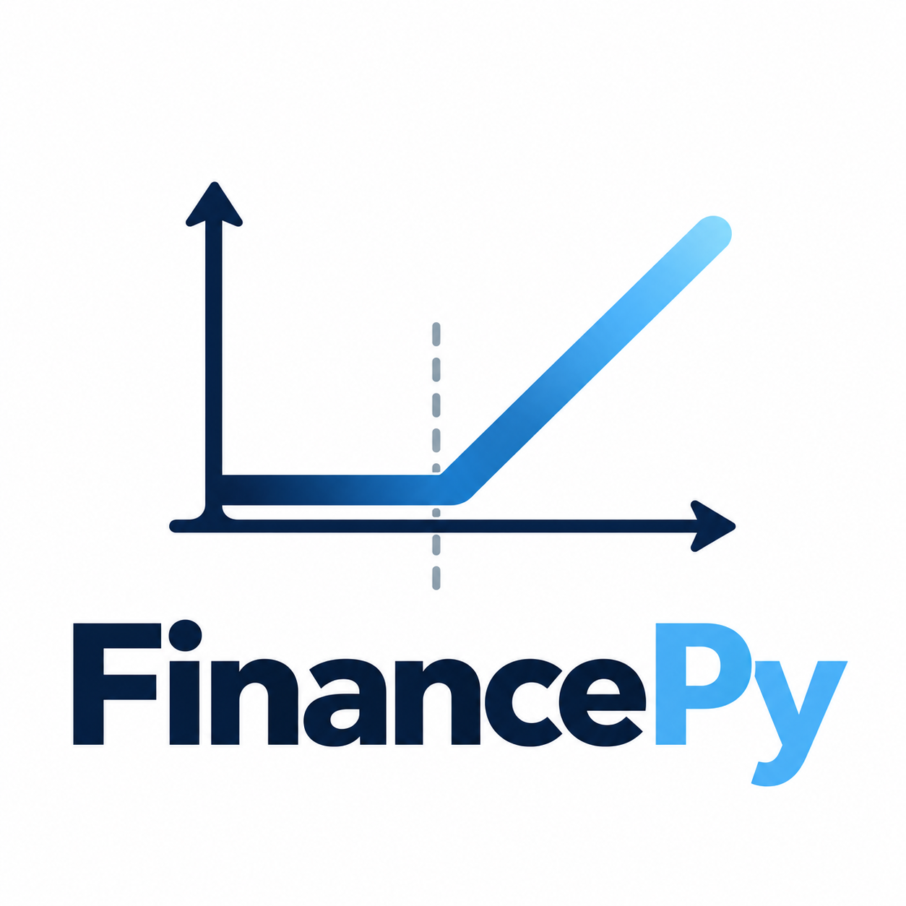

<div align="center">
  
</div>
<div align="center">

### Financial derivatives pricing and risk analytics in Python

**Transparent financial models. Practical pricing and risk analytics. An intuitive interface. Python clarity with Numba-accelerated performance.**

An open-source quantitative finance library for valuing and analysing bonds, equities, FX, interest-rate and credit derivatives. Built for quants, researchers, students and practitioners who want to understand the models they use.

[](https://pypi.org/project/financepy/)
[](https://pypi.org/project/financepy/)
[](LICENSE)
[](https://github.com/domokane/FinancePy/stargazers)

[**Documentation**](https://domokane.github.io/FinancePy/) · [**Quick start**](#quick-start) · [**Examples**](https://github.com/domokane/FinancePy/tree/master/examples) · [**Report an issue**](https://github.com/domokane/FinancePy/issues)

</div>

---

## What is FinancePy?

**FinancePy** is an open-source Python library for the **valuation and risk analysis of financial securities and derivatives**. It covers instruments across fixed income, equities, foreign exchange and credit, with an emphasis on code that can be inspected, understood and extended.

FinancePy is designed for quantitative analysts, risk managers, traders, educators and students who want to explore how financial instruments are priced and risk-managed. It is an excellent starting point for researchers wishing to test and extend existing models or to develop new models. It is a work-in-progress and contributions are welcome.

### Why FinancePy?

- **Broad product coverage** — work with bonds, options, swaps and other financial derivatives.
- **Transparent implementations** — inspect pricing logic written in Python.
- **Performance-oriented** — Numba accelerates computationally intensive models where used.
- **Product-first organization** — start from the instrument you want to value, then choose a model and market inputs.
- **Learn by example** — explore scripts, notebooks and API documentation.

>**A Simple Core idea:** 
<p align="center"><strong>Valuation = Product + Model + Market Data</strong></p>
 

## Quick start

### 1. Install

FinancePy is available on PyPI:

```bash
python -m pip install financepy
```

To upgrade:

```bash
python -m pip install --upgrade financepy
```

### 2. Verify your installation

```python
from financepy.utils import Date

settlement_date = Date(19, 2, 2026)
print(settlement_date.add_days(2))
# 21-FEB-2026
```

**Note:** The first use of some models can take longer while Numba compiles and caches optimized code. Subsequent runs can be faster.

### 3. Explore a pricing example

Start with the ready-to-run [example scripts](https://github.com/domokane/FinancePy/tree/master/examples/scripts) or [Jupyter notebooks](https://github.com/domokane/FinancePy/tree/master/examples/notebooks). These illustrate how to construct products, provide market data, select models and calculate valuations.

## What can you model?

| Area | Examples of functionality |
| --- | --- |
| **Fixed income** | Bonds, interest-rate curves, swaps and swaptions |
| **Equity derivatives** | Equity options and associated pricing models |
| **Foreign exchange** | FX derivatives and volatility surfaces |
| **Credit** | Credit instruments and credit curves |
| **Market data** | Discount curves, price inputs and volatility structures |
| **Financial utilities** | Dates, calendars, day counts and schedules |

Coverage varies by product and model. Consult the [API documentation](https://domokane.github.io/FinancePy/) and examples for the supported interfaces.

## How FinancePy is organized

The library separates the *instrument*, the *pricing model* and the *market inputs* so that each can be examined independently.

```text
financepy/
├── products/    # Financial instruments and their valuation interfaces
├── models/      # Low-level analytical and Monte Carlo pricing and valuation models
├── market/      # Curves, volatility and other market data
└── utils/       # Dates, calendars, schedules and general mathematics
```

This product-oriented design helps users find the instrument they need without first navigating every available mathematical model.

## Media Coverage

| [Stack to Street interview](https://stacktostreet.com/episodes/financepy/) | Dominic O'Kane on sell-side quant work and why transparent pricing code matters |


## Documentation and learning resources

| Resource | Description |
| --- | --- |
| [API reference](https://domokane.github.io/FinancePy/) | Classes, functions and method documentation |
| [Quick-start guides](https://github.com/domokane/FinancePy/tree/master/docs) | Introductions to major product areas |
| [Example scripts](https://github.com/domokane/FinancePy/tree/master/examples/scripts) | Runnable examples for products and models |
| [Jupyter notebooks](https://github.com/domokane/FinancePy/tree/master/examples/notebooks) | Interactive experiments and tutorials |
| [Changelog](CHANGELOG.md) | Changes across releases |

## Design philosophy

FinancePy aims to balance **clarity**, **coverage** and **speed**:

1. Keep financial calculations understandable to readers with working Python knowledge.
2. Make model implementations inspectable rather than hiding them behind compiled extensions.
3. Use Numba to improve performance where appropriate.
4. Organize functionality around financial products and practical valuation tasks.
5. Provide examples and tests that help users verify results and learn the models.

Numerical results can differ from those of other financial systems because of conventions, curve construction, interpolation choices or model assumptions. Validate inputs and outputs for your own use case.

## Contributing

Contributions from developers and finance practitioners are welcome. You can help by fixing bugs, improving documentation, adding tests, extending examples or proposing new products and models.

Before beginning a substantial change, [open an issue](https://github.com/domokane/FinancePy/issues) or comment on an existing one to coordinate work.

For more information see [contributing](https://github.com/domokane/FinancePy/CONTRIBUTING.md)

## Project status and support

FinancePy is an open-source project. If you find a defect, need a feature or want to suggest a valuation example, please [create an issue](https://github.com/domokane/FinancePy/issues) with enough detail to reproduce or evaluate the request.

**Disclaimer:** FinancePy is provided without warranty. Financial calculations should be independently checked before being used for trading, investment or risk-management decisions.

## Author

FinancePy was created by **Dominic O'Kane**, drawing on experience in quantitative finance, industry and academia.

## License

FinancePy is licensed under **GPL-3.0-or-later**. See the [LICENSE](LICENSE) file for details.

---

<div align="center">

**Explore the models · Learn from the examples · Contribute to open quantitative finance**

[Documentation](https://domokane.github.io/FinancePy/) · [Examples](https://github.com/domokane/FinancePy/tree/master/examples) · [GitHub](https://github.com/domokane/FinancePy)

</div>
